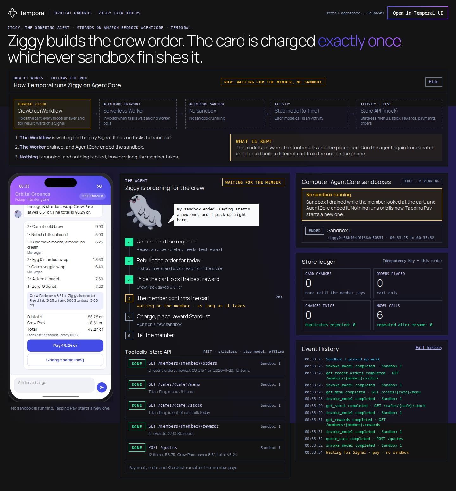

# Crew orders agent on AgentCore

A member asks the café app's agent for "the same crew order as last Friday, but Mo's vegan now", and
the agent rebuilds the order for today's menu and stock and picks the best reward. Its sandbox ends
while the member decides. When the member pays, a new sandbox charges the card exactly once and
places the order, without asking the model again. After pickup, the same agent handles support:
refunds, fresh orders and Stardust, where anything over the café's limits waits inside the agent's
tool for a person, without the agent deciding or knowing. Your Strands agent, made durable with
Temporal, running on Amazon Bedrock AgentCore.



## What's in it

- [Serverless Workers on AgentCore](https://docs.temporal.io/develop/python/workers/serverless-workers/agentcore):
  the agent's Worker runs only while there is work. Temporal Cloud invokes it when a task arrives
  and no Worker is polling; it drains once idle and AgentCore ends the session.
- [Durable Execution](https://docs.temporal.io/workflows) of an agent: every model call and tool call
  is an [Activity](https://docs.temporal.io/activities) recorded in the Event History, so a new
  sandbox resumes the agent with the same cart, without calling the model again.
- A [Signal](https://docs.temporal.io/sending-messages#sending-signals) for the member's payment:
  the server records it with no Worker running, and recording it is what starts one.
- Exactly-once checkout across retries and sandboxes: the Event History keeps a finished step from
  running again, and the Workflow ID goes to the store as the Idempotency-Key for the one gap left.
- Human in the loop inside an agent's tool: the support tools are Workflow code, so a refund over
  the limit escalates deterministically (a support agent, then a manager, then a timer) while the
  tool call waits, and the agent only sees the result.
- [Worker Versioning](https://docs.temporal.io/worker-versioning) with Pinned Workflows: an order
  finishes on the code it started on.
- A UI that reads state with Describe, the memo and the Event History. It never sends a
  [Query](https://docs.temporal.io/sending-messages#sending-queries), which would need a running
  Worker.

## How it works

```mermaid
%%{init: {"theme": "base", "sequence": {"mirrorActors": false, "boxMargin": 8, "noteMargin": 12, "messageMargin": 38}, "themeVariables": {
  "fontSize": "15px",
  "textColor": "#1ff1a5",
  "background": "#141414",
  "actorBkg": "#141414",
  "actorBorder": "#444ce7",
  "actorTextColor": "#f8fafc",
  "actorLineColor": "#465a78",
  "signalColor": "#1ff1a5",
  "signalTextColor": "#f8fafc",
  "labelBoxBkgColor": "#1a1830",
  "labelBoxBorderColor": "#7f86f1",
  "labelTextColor": "#cacbf9",
  "loopTextColor": "#cacbf9",
  "noteBkgColor": "#1a1830",
  "noteBorderColor": "#7f86f1",
  "noteTextColor": "#f8fafc",
  "activationBkgColor": "#1a1830",
  "activationBorderColor": "#1ff1a5"
}}}%%
sequenceDiagram
  rect rgb(20, 20, 20)
  participant m as Member's phone
  participant api as API (Go)
  participant t as Temporal
  box rgb(26, 24, 48) YOUR AWS ACCOUNT
  participant w as Worker on AgentCore<br/>Strands agent
  participant br as Bedrock
  end
  participant s as Store API (REST)

  m->>api: ① "Same crew order as last Friday…"
  api->>t: Start CrewOrderWorkflow
  t->>w: ② Invoke: work on the Task Queue, no Worker
  loop Every model call and tool call is an Activity
    w->>br: ③ Model call
    w->>s: Tool: orders, menu, stock, rewards, quote
  end
  w->>t: ④ Cart priced: memo update, wait for a Signal
  Note over w: ⑤ Idle: the Worker drains,<br/>AgentCore ends the session
  Note over t: Waits up to 30 min,<br/>no compute running
  m->>api: ⑥ Pay
  api->>t: Signal pay
  t->>w: ⑦ Invoke a new Worker
  w->>t: Poll, replay history,<br/>same cart, no model call
  w->>s: ⑧ Payment, order, Stardust<br/>Idempotency-Key = Workflow ID
  w->>t: "I'll let you know when it's ready",<br/>wait for a Signal
  Note over w: ⑨ Idle again: AgentCore ends the session
  api->>t: ⑩ Kitchen marks it ready: Signal kitchen_ready
  t->>w: Invoke a new Worker
  w->>t: ⑪ "Ready for pickup", Workflow completes
  end
```



1. The member asks for an order, and the API starts a `CrewOrderWorkflow`.
2. The Task Queue has work and no Worker polling it, so Temporal invokes the Worker on AgentCore.
3. The Strands agent reads the member's last orders, the café's menu and stock and the member's
   rewards from the store's REST API, then prices a cart. Each model call and each tool call runs as
   an Activity.
4. The Workflow publishes the cart through its memo and waits for the member.
5. With nothing to run, the Worker drains and AgentCore ends the idle session.
6. The member taps Pay, and the API sends the `pay` Signal.
7. Temporal invokes a new Worker, which replays the history. The model's answers and the store's
   reads come back from the history, so the agent has the same cart without calling the model.
8. The Workflow charges the card, places the order and posts the Stardust, each an Activity that
   sends the Workflow ID as its Idempotency-Key. Ziggy tells the member, and says it will let them
   know when the order is ready for pickup.
9. The Workflow waits for the kitchen. The Worker drains again and AgentCore ends the session.
10. The kitchen marks the order ready, and the API sends the `kitchen_ready` Signal.
11. Temporal invokes a new Worker, which replays the history, and Ziggy tells the member the order
    is ready for pickup.

### Support after pickup

```mermaid
%%{init: {"theme": "base", "sequence": {"mirrorActors": false, "boxMargin": 8, "noteMargin": 12, "messageMargin": 38}, "themeVariables": {
  "fontSize": "15px",
  "textColor": "#1ff1a5",
  "background": "#141414",
  "actorBkg": "#141414",
  "actorBorder": "#444ce7",
  "actorTextColor": "#f8fafc",
  "actorLineColor": "#465a78",
  "signalColor": "#1ff1a5",
  "signalTextColor": "#f8fafc",
  "labelBoxBkgColor": "#1a1830",
  "labelBoxBorderColor": "#7f86f1",
  "labelTextColor": "#cacbf9",
  "loopTextColor": "#cacbf9",
  "noteBkgColor": "#1a1830",
  "noteBorderColor": "#7f86f1",
  "noteTextColor": "#f8fafc",
  "activationBkgColor": "#1a1830",
  "activationBorderColor": "#1ff1a5"
}}}%%
sequenceDiagram
  participant m as Member's phone
  participant st as Support desk
  participant t as Temporal
  participant w as Worker on AgentCore<br/>agent + its tools
  participant s as Store API (REST)

  m->>t: ① "Issue with the entire order" (start chat, Signal report)
  t->>w: Invoke a Worker
  w->>s: GET /orders/{order}/support: what's already been done
  w->>t: ② Agent calls offer_choices: buttons, wait for a tap
  Note over w: Idle: AgentCore ends the session
  m->>t: ③ Taps "Full refund": Signal choose
  t->>w: Invoke a new Worker, replay into offer_choices
  w->>w: ④ Agent calls issue_refund. Inside the tool:<br/>policy says the refund needs a person
  w->>t: "I've escalated this", wait for Signal review<br/>or a 90 s timer, then a manager's 90 s
  Note over w: Idle: AgentCore ends the session
  st->>t: ⑤ Approve: Signal review (or the timers fire)
  t->>w: Invoke a new Worker, replay into issue_refund
  w->>s: ⑥ POST /refunds, Idempotency-Key = chat's Workflow ID
  w->>t: Tool returns "Done"; agent tells the member, chat closes
```

1. After pickup the member taps "Need help with your order?". The API reads the order from its
   Workflow's memo and starts a `SupportChatWorkflow` with it as input.
2. Before the agent starts, the Workflow looks up the order's support record in the store: what was
   paid, and every refund, free order and Stardust award from any earlier chat. The agent's prompt
   includes it, and each action tool reads it again.
3. The member picks what went wrong on a card (items missing or wrong, the whole order, or the
   service) or types it, and the page sends it as the `report` or `message` Signal.
4. The agent's tools are Workflow code, not Activities. `offer_choices` shows buttons and waits for
   a tap (the `choose` Signal), or a typed message.
5. The agent calls `issue_refund`, `place_comp_order` or `award_stardust_points`. The tool checks
   the café's policy in plain code: nothing already put right, and the order's refunds never past
   what was paid. Within the limits it calls the store at once.
6. Over the limits the tool escalates by itself: a support agent, then a manager, each with a timer,
   then approval on the last timer. The agent decides none of it and isn't told; its tool call
   returns when the store call is done.
7. Every wait ends the sandbox, and every tap, decision or timer starts a new one that replays back
   into the waiting tool call. The store calls are Activities keyed by the chat's Workflow ID, and
   the store files each in the order's record with one atomic write.
8. The chat closes once resolved, or after 3 minutes with no word from the member.

**From Strands Agents:** the agent itself. The system prompt, the tool definitions (built from the
tool functions' docstrings), the model loop that decides which tool to call next, and the Bedrock
model provider.

**From Temporal:** what makes it durable. The
[`temporalio-strands-agents`](https://pypi.org/project/temporalio-strands-agents/) plugin runs the
Strands agent inside a Workflow (`TemporalAgent`) and turns each model call and each tool call into
an Activity, with timeouts and retries. The Workflow holds the wait for the member (a Signal and a
30-minute timer) and runs checkout itself: the model never decides to charge a card. Temporal Cloud
starts the AgentCore Worker when there is work for it.

**From AgentCore:** the compute. A runtime per Worker Deployment Version, a session per invocation,
ended after 60 idle seconds.

**The store** is a mock: a stateless REST API with an embedded menu, signed quotes, and payments,
orders, Stardust, refunds and free orders written once per Idempotency-Key to DynamoDB, with one
support record per order.

| Path | What |
|---|---|
| `agent/crew/workflows.py` | The order Workflow: the agent, the wait for the member, checkout, the wait for the kitchen |
| `agent/crew/support.py` | The support chat Workflow: its tools, the café's policy and the escalation |
| `agent/crew/activities.py` | The store calls: the ordering tools, checkout, refunds and comps |
| `agent/crew/models.py` | Bedrock, or a scripted stub for offline runs |
| `agent/agentcore_worker.py` | The AgentCore entrypoint that starts and drains the Worker |
| `store/internal/store` | The mock store: menu data, quotes, the idempotent ledger |
| `api/internal/crew` | The HTTP API: start, pay, message, support, review, and one read for the whole screen |
| `api/cmd/local-invoker` | Compose only: stands in for Temporal Cloud's invoke |
| `web/` | nginx and the page |
| `deploy/demoproject.yaml` | The draft catalog entry ([docs/catalog.md](docs/catalog.md)) |

## Run it

Prerequisites: Docker, Docker Compose and `make`.

```sh
make demo
```

Open http://localhost:8080. The Temporal UI is at http://localhost:8233. Locally the agent uses a
scripted stub model, and the screen says so; `RUNBOOK.md` has how to use Bedrock instead.

Presenting it, resetting it and the code behind each beat: [RUNBOOK.md](RUNBOOK.md).

## Notes

- **No crashable workspace.** The kit's baseline is a crashable copy per presenter. The platform
  never makes a project with a serverless component crashable, so this demo keeps presenters apart
  with session-scoped Workflow IDs instead ([docs/catalog.md](docs/catalog.md), 1 to 4).
- **The store is public, behind a token.** AgentCore runtimes run in public network mode, so the
  agent reaches the store through the demo host's `/store` route, which skips sign-in. Every store
  route checks a bearer token the platform generates.
- **The plugin is `temporalio.strands_agents`.** Temporal's integration ships as the
  `temporalio-strands-agents` package; `temporalio.contrib.strands` in the SDK only re-exports it.
- **Worker status comes from Worker heartbeats,** which the Worker sends every 10 s. A Worker that
  hasn't sent one for 25 s counts as gone, because a killed Worker's last record still says Running.
- **Locally, `local-invoker` plays Temporal Cloud.** It makes the Worker Deployment Version current
  and POSTs `/invocations` when the version has backlog and no live Worker. It polls once a second,
  so it is not a model of Cloud's timing.
- **The brand is made up.** Orbital Grounds, its menu and its members are fictional.
